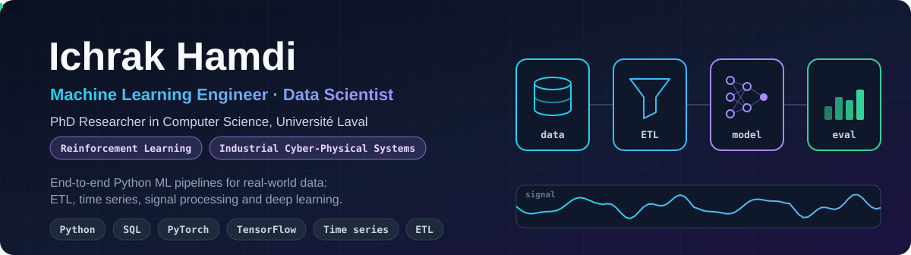
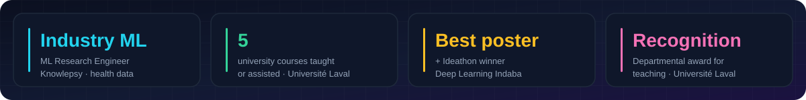
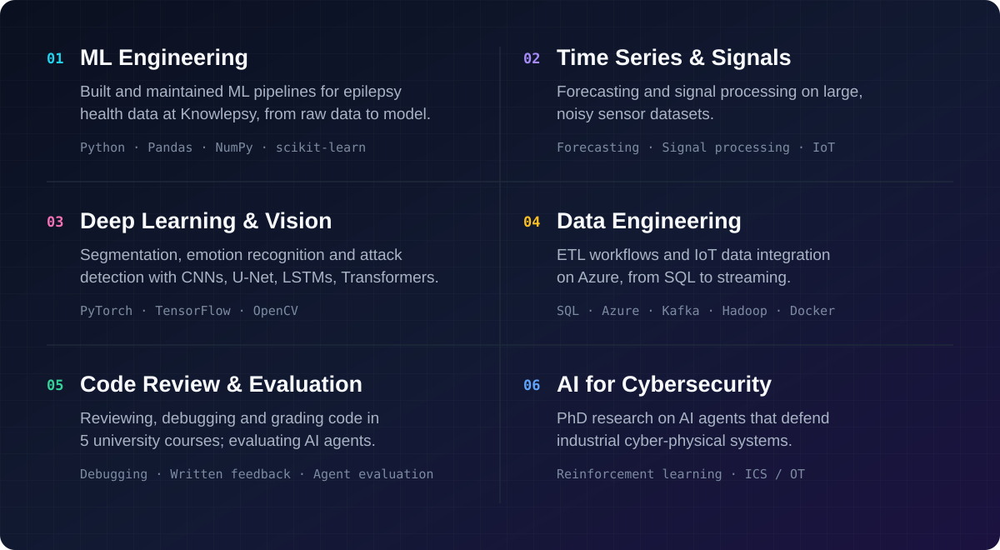
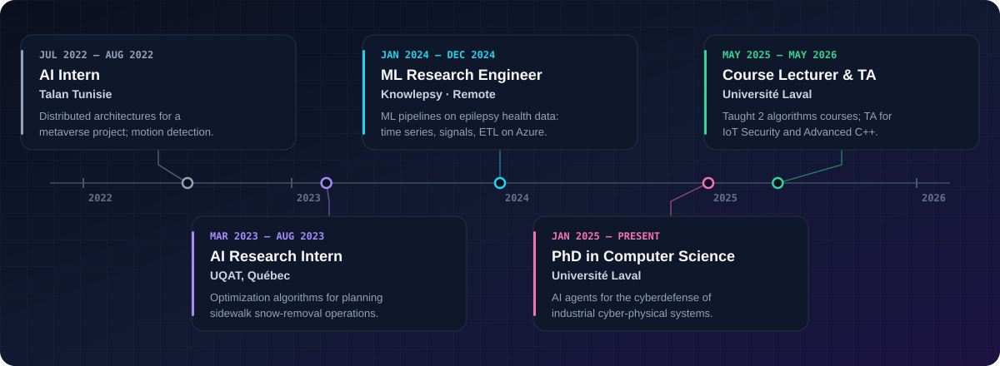
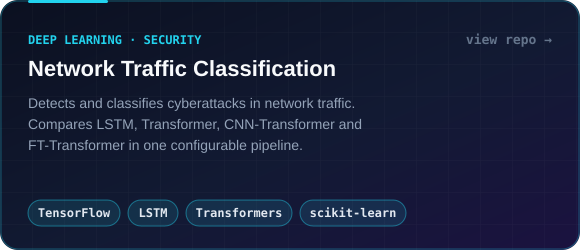
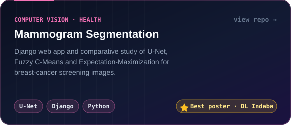
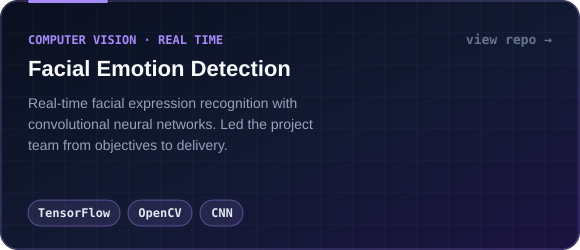
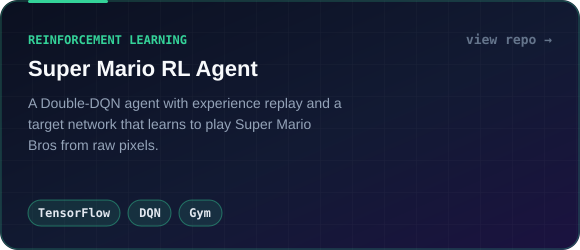

<div align="center">



<br/>

<a href="https://www.linkedin.com/in/hamdi-ichrak-740bb81b9/"></a>
<a href="mailto:ichrak.hamdi@ensi-uma.tn"></a>
<a href="https://github.com/ichrakhamdi?tab=repositories"></a>


<br/><br/>

I'm a **machine learning engineer and data scientist** doing a PhD in Computer Science at **Université Laval**.
I build **Python data pipelines and ML models for real-world, noisy data** (time series, signals, images, network traffic), and I spend a lot of my week **reviewing, debugging and giving written feedback on code** as a course lecturer and teaching assistant.

</div>

<br/>



## What I do



## Experience



## Selected projects

<p align="center">
  <a href="https://github.com/ichrakhamdi/DeepLearningProject"></a>
  <a href="https://github.com/ichrakhamdi/mammogram_segmentation"></a>
</p>
<p align="center">
  <a href="https://github.com/ichrakhamdi/Facialemotiondetection"></a>
  <a href="https://github.com/ichrakhamdi/Reinforcement-learning-Supermario"></a>
</p>

<details>
<summary><b>More projects</b></summary>
<br/>

- **[Distributed Flow-Shop Scheduling with Workers](https://github.com/ichrakhamdi/Distributed-Flow-shop-Scheduling-Problem-with-worker-Project):** a heuristic that minimizes makespan when jobs are spread across factories and each needs both a machine and a worker. `Python` `Heuristics` `Operations research`
- **[MQTT Temperature Monitoring](https://github.com/ichrakhamdi/Projet-MQTT):** a simulated IoT sensor publishing over MQTT, with a subscriber app that raises alerts past a threshold. `Java` `Python` `MQTT`
- **[Mixed-reality scene](https://github.com/ichrakhamdi/simple-scene-Mixed-Reality)** and **[Rubik's cube](https://github.com/ichrakhamdi/rubik-s-cube)** in Unity/C#, plus a **[tennis game](https://github.com/ichrakhamdi/Tennis-Game)** in C++.

</details>

## Toolbox

<div align="center">


<br/>


<br/>


<br/>


</div>

## Profile

```yaml
name: Ichrak Hamdi
role: Machine Learning Engineer · Data Scientist · PhD Researcher
location: Québec, Canada (open to remote)
education:
  - PhD, Computer Science, Université Laval (2025 to present)
  - Research Master's, Intelligent Systems, ENSI (2022 to 2023)
  - Engineering Degree, Computer Science, AI specialization, ENSI (2020 to 2023)
strengths:
  - Python data pipelines and ML on real-world data
  - Time series, signal processing, deep learning
  - Code review, debugging and written technical feedback
  - Evaluating model outputs and AI agent behavior
open_to:
  - Machine learning engineering
  - Data science
  - Code and model evaluation
```

<div align="center">

## Let's connect

Hiring for **ML engineering, data science or model evaluation**? I'd be glad to talk.

<a href="https://www.linkedin.com/in/hamdi-ichrak-740bb81b9/"></a>
<a href="mailto:ichrak.hamdi@ensi-uma.tn"></a>
<a href="https://github.com/ichrakhamdi"></a>

</div>
