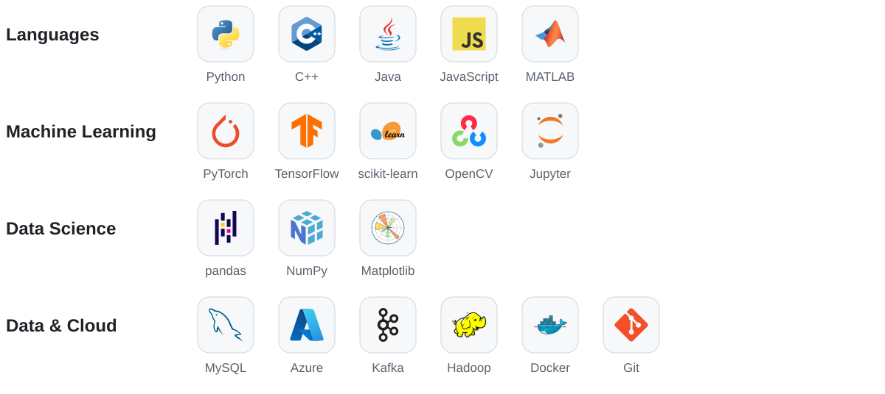
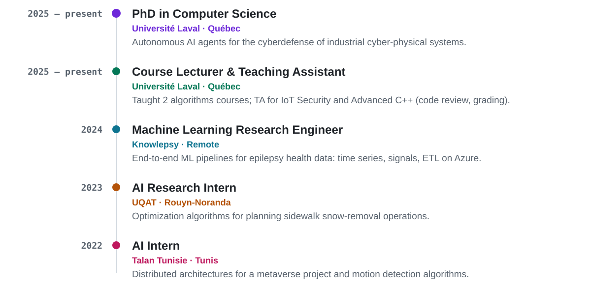
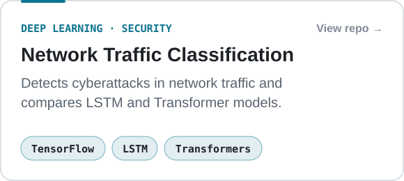
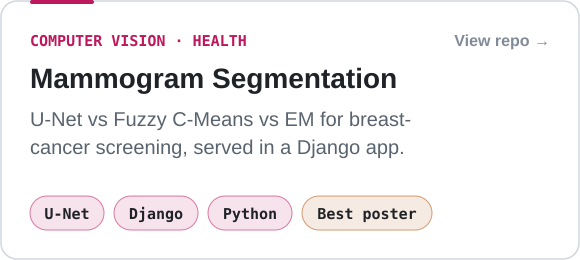
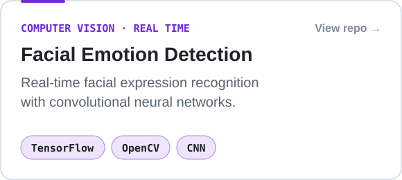
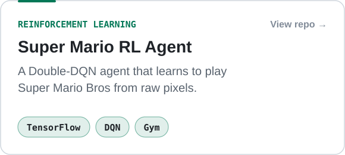
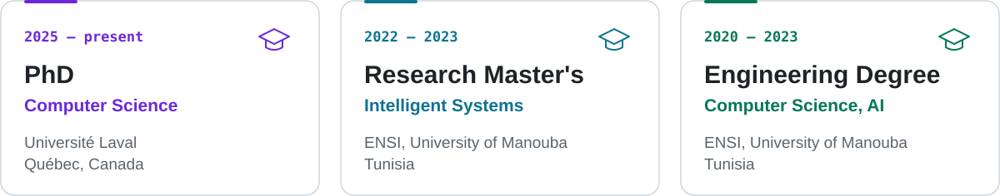

## About me

I'm a machine learning engineer and data scientist. I build Python data pipelines and models for real-world, noisy data, and I'm currently doing a PhD in Computer Science at Université Laval.

- **Now:** PhD research on reinforcement learning for the cyberdefense of industrial cyber-physical systems
- **Before:** Machine Learning Research Engineer at Knowlepsy, building ML pipelines for epilepsy health data
- **Teaching:** course lecturer and TA at Université Laval, reviewing, debugging and grading code in 5 courses

## Tech Stack

<picture>
  <source media="(prefers-color-scheme: dark)" srcset="./assets/stack-dark.svg" />
  
</picture>

**Also:** SQL · Time-series forecasting · Signal processing · ETL · JSON · YAML · Markdown · HTML · XML

## Experience

<picture>
  <source media="(prefers-color-scheme: dark)" srcset="./assets/experience-dark.svg" />
  
</picture>

## Featured Projects

  <a href="https://github.com/ichrakhamdi/DeepLearningProject"><picture><source media="(prefers-color-scheme: dark)" srcset="./assets/project-traffic-dark.svg" /></picture></a>
  <a href="https://github.com/ichrakhamdi/mammogram_segmentation"><picture><source media="(prefers-color-scheme: dark)" srcset="./assets/project-mammogram-dark.svg" /></picture></a>

  <a href="https://github.com/ichrakhamdi/Facialemotiondetection"><picture><source media="(prefers-color-scheme: dark)" srcset="./assets/project-emotion-dark.svg" /></picture></a>
  <a href="https://github.com/ichrakhamdi/Reinforcement-learning-Supermario"><picture><source media="(prefers-color-scheme: dark)" srcset="./assets/project-mario-dark.svg" /></picture></a>

<b>More projects</b>

 

| Project | What it does | Stack |
| --- | --- | --- |
| [Distributed Flow-Shop Scheduling](https://github.com/ichrakhamdi/Distributed-Flow-shop-Scheduling-Problem-with-worker-Project) | Heuristic that minimizes makespan across factories with machine and worker constraints | Python, operations research |
| [MQTT Temperature Monitoring](https://github.com/ichrakhamdi/Projet-MQTT) | Simulated IoT sensor over MQTT with threshold alerts | Java, Python, MQTT |
| [Mixed-reality scene](https://github.com/ichrakhamdi/simple-scene-Mixed-Reality) · [Rubik's cube](https://github.com/ichrakhamdi/rubik-s-cube) | Interactive 3D scenes | Unity, C# |
| [Tennis game](https://github.com/ichrakhamdi/Tennis-Game) | 2D game | C++ |

## Education

<picture>
  <source media="(prefers-color-scheme: dark)" srcset="./assets/education-dark.svg" />
  
</picture>

## Awards & Recognition

- **Best Research Poster**, Deep Learning Indaba: medical image segmentation for breast-cancer screening
- **Ideathon Winner**, Deep Learning Indaba
- **Departmental Recognition**, Université Laval: outstanding contribution as teaching assistant and course lecturer (2026)
- **Best Team**, selected by the jury at Talan Tunisie
- **Training:** DeepMind / InstaDeep, Orange Developer Center

---

**Hiring for ML engineering, data science or model evaluation? Let's talk.**

